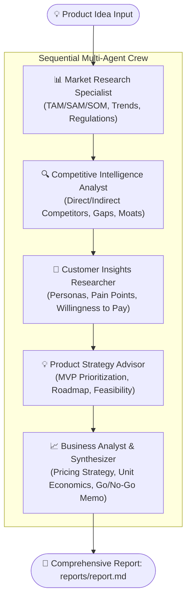

# 📈 Autonomous AI Market Research Agent

[](https://www.python.org/)
[](https://crewai.com)
[](https://streamlit.io)
[-success)](#-multi-user-authentication)
[](#-deployment)
[](LICENSE)

An enterprise-grade, autonomous multi-agent intelligence platform that converts any raw product or startup idea into a comprehensive, investor-grade market research report and strategic roadmap in minutes.

Powered by **CrewAI** with live web search and scraping tools, delivered through an interactive **Streamlit dashboard** with role-based authentication and real-time execution streaming.

---

## 🌟 Key Features

* **🤖 5-Agent Collaborative Pipeline**: Specialized autonomous agents researching TAM/SAM/SOM, competitor profiles, customer personas, technical feasibility, and financial modeling.
* **🌐 Real-Time Web Intelligence**: Autonomous web searching and page extraction using `SerperDevTool`, `ScrapeWebsiteTool`, and `SeleniumScrapingTool`.
* **🖥️ Interactive Streamlit UI**:
  * Clean form to submit product concepts with optional geographic and industry filters.
  * Real-time streaming log terminal displaying agent thoughts, tool queries, and scraping actions as they happen.
  * Interactive Markdown preview and 1-click **Download Report (.md)**.
  * Saved reports archive for viewing past research anytime.
* **🔒 Secure Multi-User Authentication**:
  * Bcrypt password hashing (`config/auth.yaml`).
  * Self-service **Create Account** tab for new users.
  * Session cookie encryption and sign-out controls.
  * CLI tool (`manage_users.py`) for administrative user management.
* **⚡ Flexible LLM Backing**: Works out-of-the-box with **Groq** (e.g. `openai/gpt-oss-120b`, `groq/llama-3.3-70b-versatile`), **OpenAI** (`gpt-4o`, `gpt-4o-mini`), **Anthropic**, or **Google Gemini** via LiteLLM.
* **🐳 Production Deployment Ready**: Pre-configured with `requirements.txt`, `Dockerfile`, and native support for **Streamlit Community Cloud**, **Render**, and **Railway**.

---

## 🧠 Multi-Agent Pipeline Architecture

The agents work in a sequential context-chaining pipeline where each agent builds on the intelligence discovered by preceding agents:



| Agent | Core Focus & Deliverables |
| :--- | :--- |
| **1. Market Research Specialist** | Quantitative market sizing (TAM/SAM/SOM), compound annual growth rate (CAGR), industry dynamics, and compliance landscape. |
| **2. Competitive Intelligence Analyst** | 5–7 in-depth competitor profiles, positioning matrices, under-served market gaps, and competitor moats. |
| **3. Customer Insights Researcher** | B2B/B2C customer personas, journey maps, urgent pain points, and acquisition channel validation. |
| **4. Product Strategy Advisor** | MVP feature prioritization (RICE / Kano framework), tech stack recommendation, and 12-month product roadmap. |
| **5. Business Analyst** | Synthesis of all data into an investment memo with pricing tiers, 3-year revenue projections, unit economics (CAC/LTV), risk matrix, and final Go/No-Go decision. |

---

## 📂 Project Structure

```text
market_reserach_agent/
├── app.py                         # Interactive Streamlit Web UI with auth & log streaming
├── Dockerfile                     # Container deployment image
├── requirements.txt               # Production Python dependencies
├── pyproject.toml                 # Package configuration
├── run_ui.bat                     # Windows 1-click launcher
├── manage_users.py                # Admin CLI to list and add users
├── .streamlit/
│   └── secrets.toml.example       # Cloud Secrets template for Streamlit Cloud deployment
├── config/
│   ├── auth.yaml.example          # Template credentials & session cookie config (tracked)
│   └── auth.yaml                  # Local credentials & active users (gitignored)
├── reports/                       # Generated research reports (.md)
│   └── .gitkeep
├── src/
│   └── market_research_agent/
│       ├── __init__.py
│       ├── crew.py                # Crew definition, toolkits, and agent assembly
│       ├── main.py                # CLI execution entry point
│       ├── config/
│       │   ├── agents.yaml        # Agent personas, roles, and backstories
│       │   └── tasks.yaml         # Task descriptions and expected outputs
│       └── tools/
│           ├── __init__.py
│           └── custom_tool.py     # Custom tool definitions
└── .env                           # Environment variables & API keys (ignored by git)
```

---

## 🚀 Getting Started

### 1. Prerequisites
* Python `3.10`, `3.11`, or `3.12` installed.
* [Git](https://git-scm.com/) installed.

### 2. Clone and Setup Environment

```bash
# Clone the repository
git clone https://github.com/YOUR_USERNAME/market-research-agent.git
cd market-research-agent

# Create and activate virtual environment
python -m venv .venv

# On Windows:
.venv\Scripts\activate

# On macOS/Linux:
source .venv/bin/activate

# Install dependencies
pip install -r requirements.txt
```

### 3. Configure API Keys

Create a `.env` file in the root directory:

```env
# Primary LLM Configuration
MODEL=openai/gpt-oss-120b
GROQ_API_KEY=your_groq_api_key_here

# (Optional: if using OpenAI instead of Groq)
# OPENAI_API_KEY=your_openai_api_key_here

# Web Search Tool Key (required for real-time market data)
SERPER_API_KEY=your_serper_api_key_here

# Authentication Toggle (true for production, false to bypass login locally)
ENABLE_AUTH=true
```

> 💡 **Where to get keys**:
> * **Groq API Key**: [console.groq.com](https://console.groq.com/) (fast inference).
> * **Serper API Key**: [serper.dev](https://serper.dev/) (2,500 free Google searches).

---

## 🖥️ Running the Application

### Option A: Interactive Web UI (Recommended)

Run the convenient Windows batch script:
```powershell
.\run_ui.bat
```
Or start Streamlit directly:
```bash
streamlit run app.py
```

The browser will open at **`http://localhost:8501`**.

#### Default Login Accounts:
| Username | Password | Role |
| :--- | :--- | :--- |
| `admin` | `adminpassword123` | Administrator |
| `analyst` | `analystpassword123` | Market Analyst |

*(New users can also self-register directly via the **📝 Create Account** tab on the login screen).*

---

### Option B: Command Line (CLI)

To kick off the crew directly in your terminal:

```bash
python -m market_research_agent.main
```
The completed report will be saved to `reports/report.md`.

---

## 🔒 Multi-User Management

You can manage user access using the built-in CLI utility:

```bash
# List all active users
python manage_users.py list

# Add a new user
python manage_users.py add <username> <password> <email> <first_name> <last_name> [role]

# Example:
python manage_users.py add sarah Pass1234 sarah@example.com Sarah Connor analyst
```

All credentials are automatically salted and hashed with **Bcrypt** into `config/auth.yaml`.

---

## 🌐 Cloud Deployment Guide

### Deploying to Streamlit Community Cloud (Free & 1-Click)

1. Push your repository to **GitHub**.
2. Visit [share.streamlit.io](https://share.streamlit.io/) and click **"Create app"**.
3. Select your repository, branch (`main`), and set **Main file path** to `app.py`.
4. Click **Advanced settings $\rightarrow$ Secrets**, and paste your configuration:
   ```toml
   MODEL = "openai/gpt-oss-120b"
   GROQ_API_KEY = "your_actual_groq_api_key"
   SERPER_API_KEY = "your_actual_serper_api_key"
   ENABLE_AUTH = true
   AUTH_COOKIE_KEY = "generate_a_random_secret_string_here"

   # Store credentials directly in Cloud Secrets (no auth.yaml file needed!)
   [credentials.usernames.admin]
   email = "admin@example.com"
   failed_login_attempts = 0
   first_name = "Admin"
   last_name = "User"
   logged_in = false
   password = "$2b$12$4dWgGRlmRz3XTSCu1TGUquGwp98ymwKqF3dHizVPdIyHdjdALIVdi"
   roles = ["admin"]

   [credentials.usernames.analyst]
   email = "analyst@example.com"
   failed_login_attempts = 0
   first_name = "Market"
   last_name = "Analyst"
   logged_in = false
   password = "$2b$12$oAKPP8FBiczkb3NAS6LUFOlWbz8UNTvPpGNkBZFVcVWiv0QbkSMqm"
   roles = ["analyst"]
   ```
5. Click **Deploy!**

---

### Deploying with Docker

Build and run anywhere with Docker:

```bash
# Build the container image
docker build -t market-research-agent .

# Run the container
docker run -p 8501:8501 --env-file .env market-research-agent
```

Access the app at `http://localhost:8501`.

---

## 🛠️ Customization

* **Change Agent Personalities**: Edit [`src/market_research_agent/config/agents.yaml`](src/market_research_agent/config/agents.yaml) to customize agent goals, roles, and backstories.
* **Modify Research Scope**: Edit [`src/market_research_agent/config/tasks.yaml`](src/market_research_agent/config/tasks.yaml) to add new deliverables, modify output word counts, or alter report sections.
* **Integrate Custom Tools**: Add new CrewAI tools in [`src/market_research_agent/tools/`](src/market_research_agent/tools/) and register them in `crew.py`.

---

## 📜 License

Distributed under the MIT License. See `LICENSE` for more information.

---

## 🤝 Support & Acknowledgements

* Built with [CrewAI](https://github.com/crewAIInc/crewAI)
* UI framework by [Streamlit](https://streamlit.io/)
* Fast inference powered by [Groq](https://groq.com/) and [LiteLLM](https://github.com/BerriAI/litellm)
* Search intelligence powered by [Serper](https://serper.dev/)
